# 🏠 RentalWorks — Complete Project Analysis Report

> **Project:** `3_Rentalworks` — PG (Paying Guest) Rental Management Platform  
> **Stack:** NestJS (TypeScript) · React 19 (Vite) · PostgreSQL (Neon) · TypeORM  
> **Analysis Date:** 25 November 2026

---

## Table of Contents

1. [Project Overview](#1-project-overview)
2. [System Architecture](#2-system-architecture)
3. [Database Schema & Entity Relationships](#3-database-schema--entity-relationships)
4. [Backend Deep-Dive (NestJS)](#4-backend-deep-dive-nestjs)
5. [Frontend Deep-Dive (React)](#5-frontend-deep-dive-react)
6. [Authentication & Authorization Flow](#6-authentication--authorization-flow)
7. [Core Business Flows](#7-core-business-flows)
8. [Frontend–Backend Communication](#8-frontendbk-communication)
9. [Role-Based Access Matrix](#9-role-based-access-matrix)
10. [Notification System](#10-notification-system)
11. [Security Architecture](#11-security-architecture)
12. [Observations & Gaps](#12-observations--gaps)

---

## 1. Project Overview

**RentalWorks** (a.k.a. *RentBro* in frontend branding) is a full-stack **PG (Paying Guest) accommodation management platform**. It manages the complete lifecycle of a paying guest stay — from public property discovery and booking, through payment and tenant onboarding, to daily warden operations and admin oversight.

### Top-Level Project Layout

```
3_Rentalworks/
├── back-end/           → NestJS REST API (TypeScript)
├── front-end-react/
│   └── pg-listing-react/   → React 19 SPA (Vite)
├── scripts/            → DB inspection / utility scripts
├── definitions.yml     → Domain definitions
├── DomainExpertInteraction.md
└── SRS.pdf             → Software Requirements Specification
```

---

## 2. System Architecture

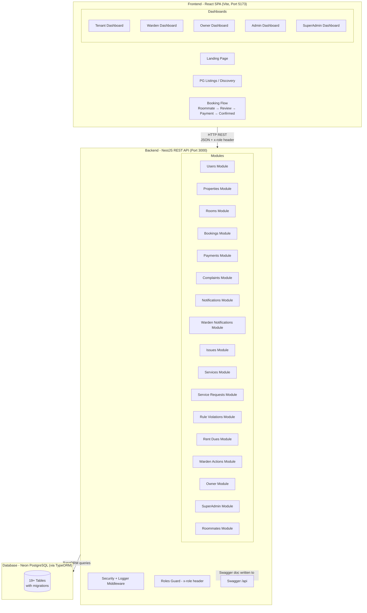

---

## 3. Database Schema & Entity Relationships

### Entity Map

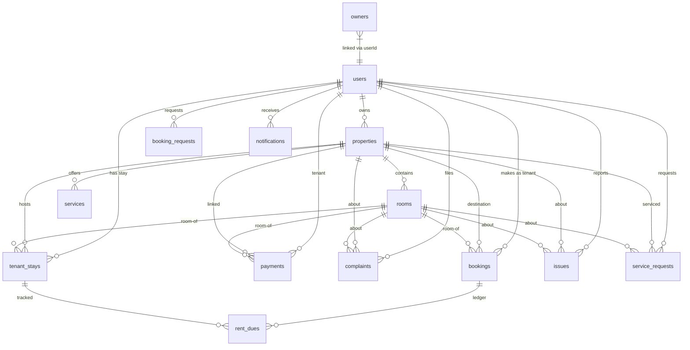

### Key Entities & Fields

| Entity | Key Fields | Purpose |
|--------|-----------|---------|
| `users` | id, name, email, phone, role, gender, status, username, password | Central user table for all roles |
| `properties` | id, name, location, ownerId, rentMin/Max, amenities, status, gender, rules, images | PG listings |
| `rooms` | id, roomNumber, propertyId, capacity, currentOccupancy, rent, status | Room inventory |
| `bookings` | id, tenantId, propertyId, roomId, room, bedNumber, checkIn, rent, status | Booking records |
| `payments` | id, tenantId, propertyId, amount, method, transactionId, kind, rentAmount, depositAmount, feeAmount | Payment records with breakdown |
| `tenant_stays` | id, tenantId, propertyId, roomId, bedNumber, moveInDate, status, endedAt, endReason | Active stay tracking |
| `rent_dues` | id, tenantId, cycleNo, periodStart, periodEnd, dueDate, amount, status | Monthly rent ledger |
| `notifications` | id, userId, title, message, type, priority, read | Tenant/admin notification inbox |
| `warden_notifications` | id, tenantId, propertyId, roomNumber, priority, read | Warden-specific alerts |
| `complaints` | id, tenantId, propertyId, roomId, priority, description, status | Tenant → warden complaints |
| `issues` | id, tenantId, propertyId, roomId, category, priority, status | Maintenance issue tickets |
| `rule_violations` | id, tenantId, propertyId | Warden-issued rule violations |
| `audit_logs` | id, action, actorId, actorRole, tenantId, details | Warden action audit trail |
| `owners` | id, userId, fullName, email, company, city | Owner profile (separate from users) |
| `subscriptions` | id, ... | Owner subscription plans |
| `services` | id, propertyId | Available services at a property |
| `service_requests` | id, tenantId, propertyId | Tenant service requests |
| `booking_requests` | id, tenantId, propertyId | Pre-checkout booking requests |
| `roommate_profiles` | id, ... | Lifestyle matching profiles |

---

## 4. Backend Deep-Dive (NestJS)

### 4.1 App Bootstrap (`main.ts`)

The app boots on **port 3000** with these global configurations:

| Feature | Setting |
|---------|---------|
| CORS | `origin: '*'` (all origins — dev mode) |
| Helmet | Enabled for HTTP security headers |
| ValidationPipe | `whitelist: true`, `transform: true`, `forbidNonWhitelisted: true` |
| Swagger | Mounted at `/api`, saved to `docs/swagger.json` |
| Auth headers | Global Swagger params: `x-role`, `x-user-id` |

### 4.2 Module Structure

The `AppModule` registers **17 feature modules**, global TypeORM config (Neon PostgreSQL via `DATABASE_URL`), and two middleware classes applied globally.

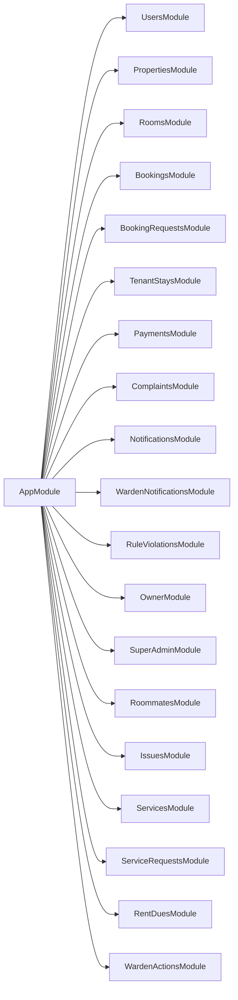

### 4.3 Middleware Pipeline

Every request passes through:

1. **`SecurityMiddleware`** — Adds `X-Custom-Security: Rentalworks-Secure` header; blocks `curl` on `/admin` routes.
2. **`LoggerMiddleware`** — Request logging (Winston).
3. **`RolesGuard`** — Header-based role check (see §6).
4. **`HttpErrorFilter`** — Formats all exceptions into consistent JSON error responses.

### 4.4 Key API Endpoints

#### Users (`/users`)
| Method | Endpoint | Roles | Description |
|--------|----------|-------|-------------|
| POST | `/users/login` | Public | Username/email/phone + password login |
| POST | `/users/guest-login` | Public | Login restricted to guest/tenant |
| POST | `/users/guest-register` | Public | Register or return existing guest |
| POST | `/users/owner-register` | Public | Owner + property application |
| GET | `/users/tenants` | admin, warden | All tenants with booking+stay+payment |
| POST | `/users/tenants` | admin, warden | Create tenant (transactional) |
| PUT | `/users/tenants/:id` | admin, warden | Update tenant info, room, payment |
| DELETE | `/users/tenants/:id` | admin, warden | Remove tenant + cascade records |
| POST | `/users/upload-avatar` | Authenticated | Multer file upload |
| GET | `/users` | admin, warden, super_admin | All users |
| GET | `/users/:id` | All roles | Get user by ID |
| PUT | `/users/:id` | All except super_admin create | Update profile |

#### Bookings (`/bookings`)
| Method | Endpoint | Roles | Description |
|--------|----------|-------|-------------|
| POST | `/bookings/checkout` | Public | Complete guest-to-tenant conversion |
| GET | `/bookings` | All | List with tenantId/propertyId filter |
| POST | `/bookings` | admin, tenant, warden | Create pending booking |
| PUT | `/bookings/:id` | admin, warden | Update status/room |
| DELETE | `/bookings/:id` | admin, tenant | Cancel booking |

#### Payments (`/payments`)
| Method | Endpoint | Roles | Description |
|--------|----------|-------|-------------|
| GET | `/payments/revenue` | super_admin, admin | Platform revenue total |
| GET | `/payments` | All except guest | With tenantId/propertyId filters |
| POST | `/payments` | super_admin, admin, tenant | Submit payment |
| PUT | `/payments/:id` | super_admin, admin, owner | Update status |

---

## 5. Frontend Deep-Dive (React)

### 5.1 Tech Stack

| Item | Version | Role |
|------|---------|------|
| React | 19.x | UI framework |
| Vite | 8.x | Build tool + dev server |
| React Router | 7.x | Client-side routing |
| oxlint | 1.x | Linting |

> **No Redux, No Zustand** — State is managed via React Context (`BookingContext`, `AuthContext`) and browser storage (sessionStorage / localStorage).

### 5.2 Route Architecture

The app has **5 distinct dashboard portals** plus a public booking funnel:

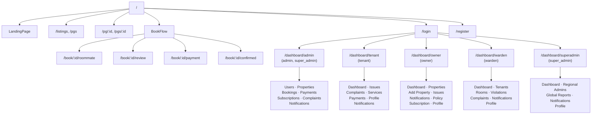

### 5.3 Session & Storage Model

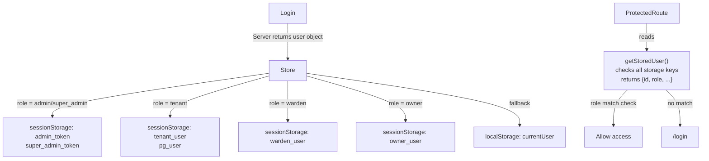

> [!NOTE]
> `getStoredUser()` checks multiple keys in priority order: `pg_user` → `guest_user` → `tenant_user` → `warden_user` → `localStorage.currentUser`. The key used depends on the role-specific login flow.

---

## 6. Authentication & Authorization Flow

### 6.1 Standard Login Flow

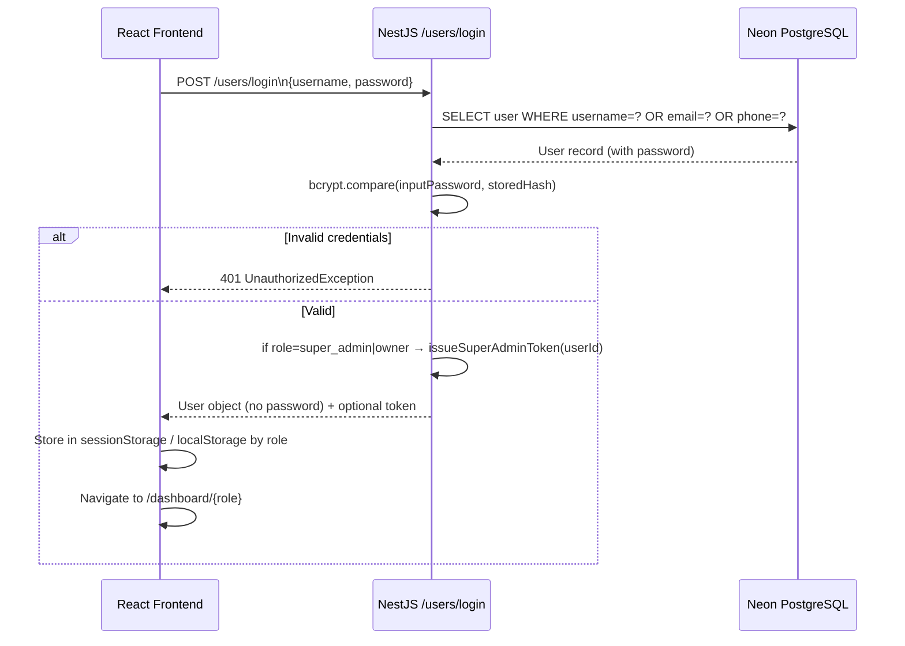

### 6.2 Super Admin Token System

Super admin and owner roles receive a **custom HMAC-signed bearer token** (not JWT):

- `issueSuperAdminToken(id)` — Creates `base64url(payload).HMAC_SHA256_signature`
- Payload: `{ id: userId, expires: now + 8h }`
- `verifySuperAdminToken(header)` — Timing-safe comparison, validates expiry
- Secret: `SUPER_ADMIN_TOKEN_SECRET` (must be ≥32 chars in `.env`)

### 6.3 Backend Role Guard (`RolesGuard`)

```
Request → Check @Roles() decorator on handler
         ↓
         If no roles required → allow (public endpoint)
         ↓
         Read 'x-role' header from request
         ↓
         If x-role = 'super_admin' → verify Bearer token + DB lookup
         ↓
         Otherwise → check if x-role is in allowed roles list
         ↓
         Allow or Reject (403)
```

> [!IMPORTANT]
> The backend does **NOT use JWT for regular users**. Regular role verification is purely based on the `x-role` header value sent by the frontend. There is **no cryptographic verification** of the role claim for non-super-admin roles — a client could technically send any role.

### 6.4 Frontend Route Guard (`ProtectedRoute`)

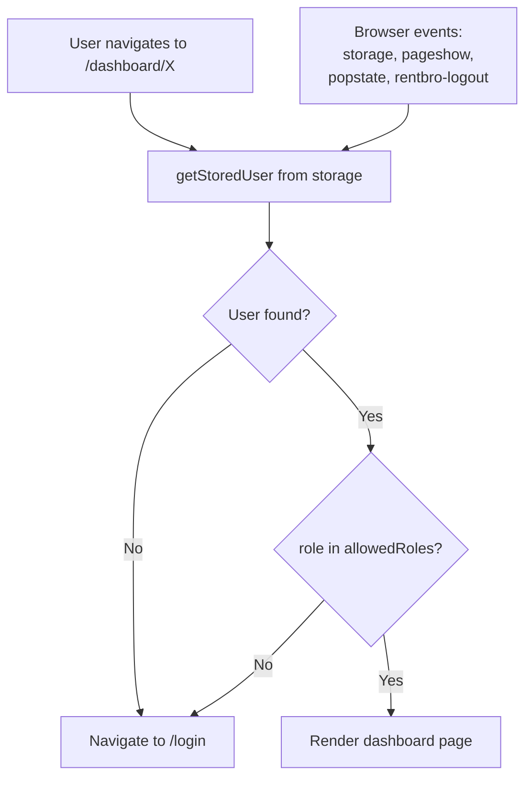

### 6.5 Logout Flow

```
performLogout() → clearAuthSession() → remove all storage keys
                → dispatch 'rentbro-logout' event
                → dispatch 'storage' event  
                → window.location.replace('/login')
```

---

## 7. Core Business Flows

### 7.1 Guest Booking & Checkout Flow (Most Complex)

This is the **central business process** — a guest browses, books, pays, and becomes a tenant.

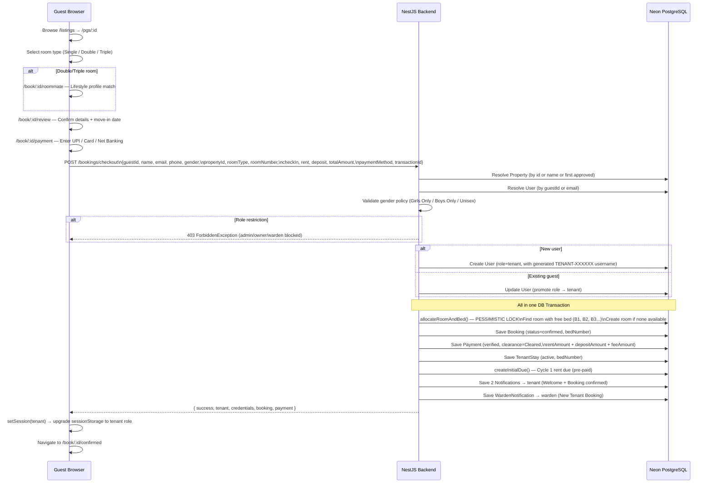

### 7.2 Tenant Dashboard Flow

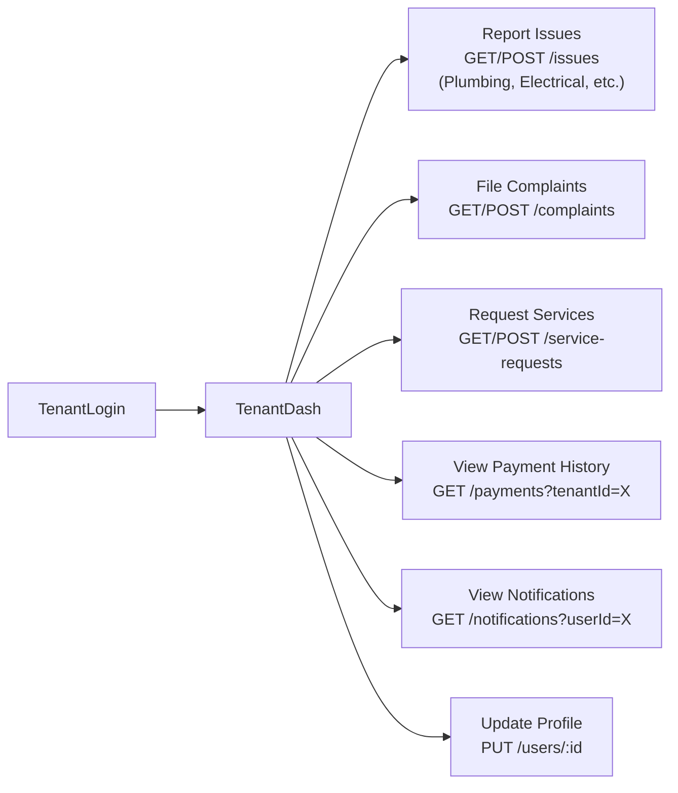

### 7.3 Warden Operations Flow

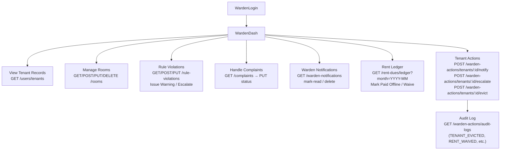

### 7.4 Owner Registration & Property Onboarding Flow

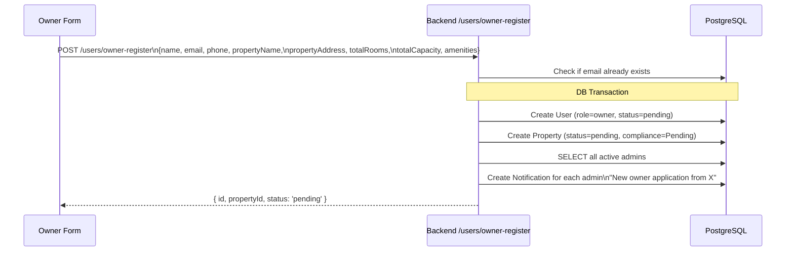

### 7.5 Admin → Owner Approval Flow

Admin dashboard fetches pending users/properties, updates `status` from `pending` → `approved` via:
- `PUT /users/:id` — Activate owner user account
- `PUT /properties/:id` — Approve property listing

### 7.6 Rent Dues Lifecycle

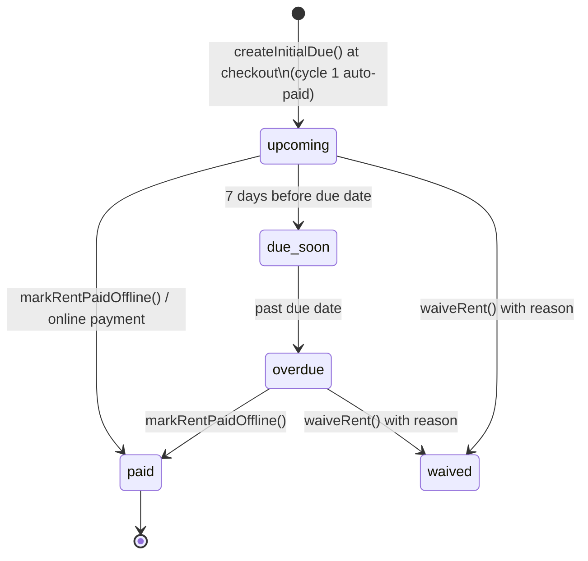

---

## 8. Frontend–Backend Communication

### 8.1 API Abstraction Pattern

Each dashboard module has its own `api.js` or `services/api.js` file. All use native `fetch()` with role-specific headers:

```javascript
// Pattern used across all dashboard API utilities
const headers = {
  'Content-Type': 'application/json',
  'x-role': activeUser.role,     // Role sent in every request
  'x-user-id': activeUser.id,    // User ID sent in every request
};
// Super admin also sends: 'Authorization': `Bearer ${token}`
```

| Dashboard | API File Location |
|-----------|------------------|
| Tenant | `src/dashboards/tenant/services/api.js` |
| Warden | `src/dashboards/warden/utils/api.js` |
| Admin | `src/dashboards/admin/utils/` |
| Owner | `src/dashboards/owner/` |
| SuperAdmin | `src/dashboards/superadmin/` |

### 8.2 Base URL Configuration

```javascript
const BASE_URL = import.meta.env.VITE_API_URL || 'http://localhost:3000';
```

> [!IMPORTANT]
> The base URL defaults to `http://localhost:3000`. For production, `VITE_API_URL` must be set at build time.

### 8.3 Request Flow Diagram

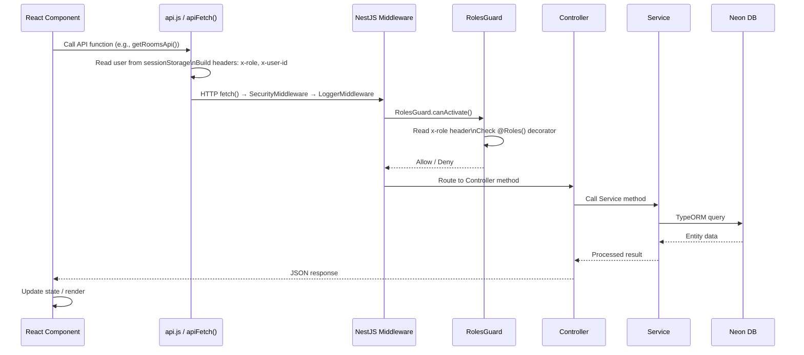

### 8.4 Error Handling

The `HttpErrorFilter` on the backend catches all thrown exceptions and returns:

```json
{
  "statusCode": 400,
  "message": "Human-readable error description",
  "timestamp": "ISO timestamp",
  "path": "/endpoint/path"
}
```

Frontend catches errors in try/catch blocks and displays inline error banners.

---

## 9. Role-Based Access Matrix

| Resource / Action | super_admin | admin | owner | warden | tenant | guest |
|-------------------|:-----------:|:-----:|:-----:|:------:|:------:|:-----:|
| View all users | ✅ | ✅ | ❌ | ✅ | ❌ | ❌ |
| Create user | ✅ | ✅ | ❌ | ❌ | ❌ | ❌ |
| Delete user | ✅ | ✅ | ❌ | ❌ | ❌ | ❌ |
| View tenants list | ✅ | ✅ | ❌ | ✅ | ❌ | ❌ |
| Create tenant | ✅ | ✅ | ❌ | ✅ | ❌ | ❌ |
| View all bookings | ✅ | ✅ | ✅ | ✅ | own | own |
| Create booking | — | ✅ | ❌ | ✅ | ✅ | ❌ |
| Checkout (booking) | ✅ | ✅ | ❌ | ❌ | ✅ | ✅ |
| View payments | ✅ | ✅ | ✅ | ✅ | own | ❌ |
| Platform revenue | ✅ | ✅ | ❌ | ❌ | ❌ | ❌ |
| Manage properties | ✅ | ✅ | own | ❌ | ❌ | ❌ |
| Manage rooms | ✅ | ✅ | ❌ | ✅ | ❌ | ❌ |
| File complaints | — | ✅ | ❌ | ❌ | ✅ | ❌ |
| Handle complaints | — | ✅ | ❌ | ✅ | ❌ | ❌ |
| File issues | — | ❌ | ❌ | ❌ | ✅ | ❌ |
| Handle issues | — | ✅ | ❌ | ✅ | ❌ | ❌ |
| Rule violations | — | ✅ | ❌ | ✅ | ❌ | ❌ |
| Rent dues ledger | — | ✅ | ❌ | ✅ | own | ❌ |
| Evict tenant | — | ❌ | ❌ | ✅ | ❌ | ❌ |
| Audit logs | — | ✅ | ❌ | ✅ | ❌ | ❌ |
| Owner application | — | ✅ | — | ❌ | ❌ | ❌ |
| Subscriptions | ✅ | ✅ | ✅ | ❌ | ❌ | ❌ |
| Global reports | ✅ | ❌ | ❌ | ❌ | ❌ | ❌ |
| Regional admins | ✅ | ❌ | ❌ | ❌ | ❌ | ❌ |
| Warden notifications | — | — | ❌ | ✅ | ❌ | ❌ |

---

## 10. Notification System

The platform has **two separate notification channels**:

### 10.1 Tenant/Admin Notifications (`notifications` table)

- **Who receives:** Individual users (by `userId`)
- **Who sends:** Backend services (auto-generated on events)
- **Key events that generate notifications:**
  - Checkout → Welcome notification + Booking confirmed
  - Owner registration → Admin notification
  - Warden actions → Tenant notification
- **Fields:** `title`, `message`, `type`, `priority`, `userId`, `targetPropertyId`, `read`

### 10.2 Warden Notifications (`warden_notifications` table)

- **Dedicated channel** for operational alerts to wardens
- **Triggered by:** Completed checkouts (new tenant move-in)
- **Contains:** `tenantId`, `propertyId`, `roomNumber`, `senderName`, `sourceReferenceId`
- **Actions:** Mark read, mark all read, delete
- **Priority:** High (new booking) or normal

### 10.3 Notification Flow Summary

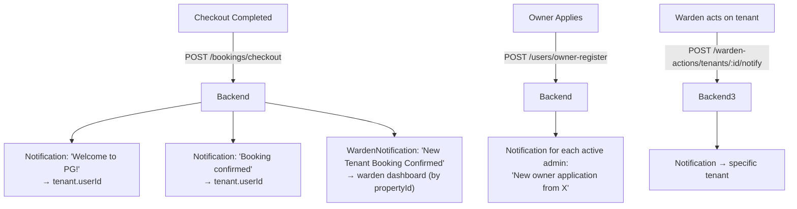

---

## 11. Security Architecture

### 11.1 Backend Security Layers

| Layer | Mechanism | Coverage |
|-------|-----------|----------|
| HTTP Headers | Helmet middleware | XSS, MIME sniffing, Clickjacking, etc. |
| Input Validation | NestJS ValidationPipe + class-validator | DTO whitelist, type transform |
| Role Authorization | `RolesGuard` + `@Roles()` decorator | Per-endpoint role enforcement |
| Super Admin Auth | HMAC-SHA256 signed token (8h TTL) | Cryptographically verified |
| Password Hashing | bcrypt (10 rounds) | All user passwords |
| Concurrency Safety | TypeORM `pessimistic_write` lock | Room/bed allocation race conditions |
| DB Uniqueness | Partial unique index on `active_stay_bed` | Last-line defence for double-booking |
| Error Handling | `HttpErrorFilter` | No stack traces exposed |
| CORS | `origin: '*'` | ⚠️ Open (dev-only setting) |

### 11.2 Frontend Security

| Mechanism | Implementation |
|-----------|---------------|
| Route protection | `ProtectedRoute` checks storage on every navigation event |
| Logout robustness | Clears all storage keys + fires custom events to close all tabs |
| Browser back protection | `window.location.replace('/login')` prevents back-navigation to auth pages |
| Session scope | `sessionStorage` preferred (tab-scoped, cleared on close) |

### 11.3 Known Security Gaps

> [!WARNING]
> The following are present in the codebase and should be addressed before production:

1. **No role verification for regular users** — The `x-role` header is taken at face value for non-super-admin roles. Any client can send `x-role: admin` to gain admin access.
2. **CORS is `origin: '*'`** — Must be locked to specific origins in production.
3. **`synchronize: false`** — Good (migrations-based), prevents accidental schema destruction.
4. **Super admin token is NOT JWT** — Custom HMAC is fine but non-standard; 8h session with no refresh or revocation mechanism.

---

## 12. Observations & Gaps

### ✅ What Works Well

- **Transactional checkout**: The 7-step `completeCheckout` transaction is atomic — user creation, booking, payment, stay, rent due, notifications all succeed or all rollback.
- **Bed-level allocation with locking**: `pessimistic_write` + unique index prevents double-booking at the DB level.
- **Migration management**: All schema changes go through TypeORM migrations with explicit names and timestamps.
- **Dual notification channels**: Separating warden notifications from general notifications prevents inbox clutter.
- **Audit trail**: Warden actions (evict, notify, escalate, waive) are all written to `audit_logs` for accountability.
- **Gender policy enforcement**: Both frontend and backend validate property gender policy during booking.
- **Credential handling**: Existing guest passwords are never overwritten on tenant promotion.

### ⚠️ Areas to Improve

| Issue | Impact | Recommendation |
|-------|--------|---------------|
| `x-role` header not verified | Critical security gap | Implement JWT with role claim |
| CORS `*` | Security | Lock to frontend origin |
| No refresh token | UX | Implement token rotation |
| `propertyId: 1` hardcoded | Multi-property bug | Resolve from warden's assigned property |
| `password: 'tenant123'` default | Security | Require real password on tenant create |
| Super admin token no revocation | Security | Add token blacklist or short TTL + refresh |
| No rate limiting | DoS vulnerability | Add `@nestjs/throttler` |
| No WebSocket/SSE | Notifications stale | Add real-time push for warden dashboard |
| `origin: '*'` CORS in main.ts | Security | Configure env-based allowed origins |
| File uploads stored locally | Infra gap | Move to cloud storage (S3/GCS) |

### 📊 Codebase Stats

| Metric | Count |
|--------|-------|
| Backend modules | 17 |
| DB entities | 19+ |
| DB migrations | 8 |
| Frontend dashboard portals | 5 |
| Total frontend pages/routes | ~40 |
| User roles | 6 (super_admin, admin, owner, warden, tenant, guest) |
| Payment methods supported | 3 (UPI, Card, Net Banking) |
| Issue categories | 8 (Plumbing, Electrical, Cleaning, Maintenance, Internet, Security, Appliances, Other) |

---

*Report generated by Antigravity Analysis — 25 November 2026*
